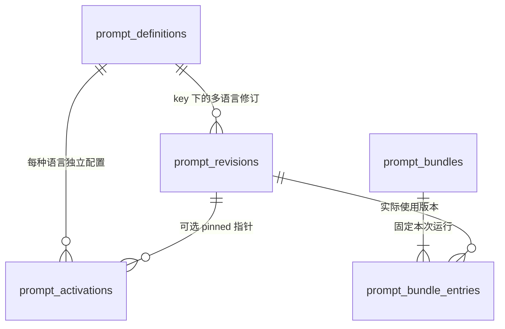

# Agent Note: 多语言提示词管理与数据库版本设计

2026-11-08 L6工程完成：2018项中英资源、同步/设置/维护剩余入口、稳定错误与原始详情、平台文案及AST/ARB防漏门禁完成；Flutter600项、Rust1132 passed / 20 ignored、lib/tool analyze、release通过，FRB hash -479447412。Android原生arm64编译通过；ADB无设备，L7真模型/设备/多设备验收保持未完成。最新覆盖与命令见多语言路线及覆盖清单，以下为历史阶段记录。

Status: proposed

2026-11-07 L5工程交付：迁移74、签名数据集知识语言/增量与快照v10、应用能力和接管门禁、任务与缓存策略隔离、产物语言metadata及设置修改接通。Rust all-targets库1128+集成2（1130 passed / 20 ignored）、Flutter全量572项、真实Bridge3项、analyze和release通过；语言切换不整库重跑，旧工作继续原bundle。L6全应用文案/错误与L7真实模型和设备仍未完成，Goal继续。

2026-11-07 L6首批推进：待办/习惯提醒、首批稳定错误码与详情、托盘/Android通知标签及对象同步冲突接通，资源896项，覆盖/ICU检查入CI。Rust完整1131 passed / 20 ignored、Flutter最终581项、同步冲突/托盘/通知增量20项、11入口analyze及release通过。Android Kotlin编译受embedding依赖与Google Maven超时阻塞，未算通过。L6其余知识库/同步/设置与L7真实验收保持未完成。

2026-11-07 L6知识库增量：分页列表/筛选/阅读状态、导入表单/负知识与新版本确认/网页预览、页签和正文编辑/标签/复制/沉浸操作接入双语。知识页编辑错误改为稳定code，保留乐观锁与显式覆盖；英文窄屏溢出已修正，切语言保留搜索/标签/未保存正文。资源1018项，候选1327项/98文件；Rust全量1131 passed / 20 ignored、Flutter全量588项、知识库专项35项、14入口analyze及release通过。推文专用预览/整理、实体/派生/维护、其余同步与设置继续，L6和L7仍未完成。


实施归属（2026-11-06）：P3由[中英文支持 Roadmap](../../../roadmap/2026-11-06-multilingual-support-roadmap.md)的L1、L3–L5及L7承接；界面覆盖另含L2/L6。L1偏好持久化/规范化/CAS、UI有效locale接入已交付，[验证记录](../../implemented/architecture/2026-11-06-multilingual-runtime.md)；L3.1/3/5双语模板/变体设置、实际bundle语言与部分动态上下文/工具说明已接通，专项证据见记录；L3剩余动态指令与完整运行回归、L4行为、L5知识语言同步继续实施。本文保留运行与数据契约，具体进度统一记录于该路线。

2026-11-07 L6知识库第三批：推文预览的 AI Markdown 整理改为后端双语 Prompt 资源，整理任务记录 `preserve_source` 策略，原文语言不被聊天回答语言设置覆盖；整理仅生成预览，仍需用户点击保存才写入来源和派生产物。推文讨论、原文复制、保存/失败、窄屏输入与热切换接入双语。派生版本列表、正文按需读取、模型/流程/生成指令、采用/撤销采用、比较/复制/分页和错误详情接入双语；实体合并/撤销、结构化事实、来源事件、关联待办、相关指导及反馈错误接入双语，窄屏合并操作改为换行布局。原始事实、来源、生成指令、wire值和实际修订 ID 保持不变。

新增导入整理的稳定数据边界测试：原文作为 user 数据发送，系统指令按当前 bundle 选择中英文，整理请求不携带工具，不写事件或知识页；空正文返回 `field_required(content)`。Prompt 运行记录显示“保留来源原文语言”，不伪装成 `zh`/`en` 回答策略。脚本生成器跳过重复 FVM 安装，仍由项目 FVM 生成桥接和 release。

本批资源达到1102项，候选1207项/93文件；ARB/参数/ICU检查通过。Flutter全量**594 passed**（`/tmp/i18n-l6-preview-ui-all-delivery.log`），本批推文/派生/实体专项32项（`/tmp/i18n-l6-preview-domain-tests-clean.log`），Prompt专项32项（`/tmp/i18n-l6-preview-prompt-regression.log`），Rust全量**1130 passed / 20 ignored**（`/tmp/i18n-l6-preview-all-targets.log`），整理策略专项1项（`/tmp/i18n-l6-import-format-policy-rust-final.log`），9入口analyze无问题（`/tmp/i18n-l6-preview-delivery-analyze.log`），release通过（`/tmp/i18n-l6-preview-policy-release-final.log`）。桥 hash 已更新为 `-479447412` 两侧一致。L6剩余同步配对/owner、Provider/知识页冲突卡、数据/运行日志、规则/关系/情绪、搜索/代理/技能/MCP设置及Android原生验证；L7真实模型/设备仍未做。

## Problem

内置提示词分散在 Rust 常量与动态字符串中，调整角色、风格和处理策略需要重编译。主对话基础指令混合角色语气、功能说明、文本工具协议、规则提议格式与确认纪律，无法独立编辑和验证。

未来应用需要多语言。仅给 prompt 表增加 language 列不足以处理译文修订、语言回退、运行一致性和缓存隔离；给每种语言增加一列也无法扩展。界面语言、指令语言、回答语言和知识库产出语言不能共用一个开关。

2026-11-05 代码核对：

- `src/ai/memory/prompts.rs` 存基础指令与工具指南，`system_context.rs` 动态组装场景与事实。
- `src/ai/summary.rs` 使用固定 `chat-summary-v1` 与 provider basis 查缓存；`src/knowledge/reading.rs` 使用 `fulltext-v1`，均未绑定具体指令内容版本。
- 文本工具与规则提议使用 `[工具调用]`、`[规则提议]`、`[规则本质]`，这些是协议常量，不能随模板翻译改名。
- Flutter 的 `AppSettings.language`、`updateLanguage` 已有占位，尚未贯通持久化、应用本地化和后端语言决策，不能据此宣称支持多语言。

本文扩展同日初步评估，作为后续实现的数据库与运行契约。本次只交付设计，不执行 migration 或改变模型行为。

## Proposal

采用**应用内置默认资源 + 数据库不可变修订 + 按语言激活配置**。实际用过的内置与自定义文本均可追溯。自定义指令可以即时启用、回滚；业务 key、变量、输出契约和执行权限由代码注册。

同一提示词按 `(prompt_key, locale)` 保存多个语言变体，每个变体独立保留修订。不设置 `body_zh`、`body_en` 等语言专列，也不把所有译文放在同一 JSON 字段中。

### 1. 内容与边界

| 层 | 内容 | 管理方式 |
|---|---|---|
| 语义指令 | 角色、风格、总结重点、分析和消化方法 | 默认资源；数据库自定义版本覆盖 |
| 固定模型契约 | 输出要求、证据/确认提示、语言指令、协议说明 | 可本地化的只读资源，保留版本；应用选择 |
| 工具描述 | 工具和参数的自然语言说明 | 稳定 key 的语言资源；工具名、字段名固定 |
| 动态材料 | 目标、规则、原文、历史、时钟、工具结果 | 各自真源动态组装，不进入模板正文 |
| 执行约束 | 审批、证据、原文保护、schema、预算 | Rust 确定性检查，不受模板编辑授权 |
| 界面文案 | 设置项、按钮、错误展示、日期格式 | Flutter 本地化资源，prompt 表不替代 ARB |

契约的自然语言说明可翻译；JSON key/枚举、工具名、引用 slug 和协议标记保持字面不变。第一期继续在各语言模板中插入现有中文协议常量。改成语言无关协议须独立升级解析器、兼容旧消息，不在文本迁移中顺带改名。

### 2. 四种语言分别决策

| 属性 | 示例 | 含义 |
|---|---|---|
| `ui_locale` | `en-GB` | 当前设备显示语言，由 Flutter 提供，不自动翻译用户数据 |
| `instruction_locale` | `zh-Hans` | 本机显式设置优先，否则跟随 UI；决定模板候选语言 |
| `response_policy` | `auto` / 固定 `en` | 当前对话回答策略，与指令语言独立 |
| `knowledge_output_locale` | `zh-Hans` | 数据集的知识产出语言，后台不读取当前 UI 语言 |

对话默认 `auto`：模型按用户本轮明确语言要求优先，其次按消息主要语言；短问号、代码或无法判断的输入沿用会话最近可靠语言，否则采用运行固定的回退语言。首期不为语言检测增加额外 LLM 请求。

会话与本轮结构化任务可以指定固定回答语言，本轮显式指定优先。自然语言“请用英文回答”由模型遵循，未可靠识别前不声称后端已确定了实际输出语言。`auto` 原样写入运行证据；可选的输出检测字段必须叫检测结果，不能当作语言指令执行成功的证明。

后台知识产出及内部可复用摘要/阅读归纳使用数据集固定语言。已有页面修订默认保留页面主要语言，明确翻译则走翻译任务/派生稿与审阅；原始事件、页面原文、验证引文、代码和标识不翻译。切换 UI、prompt 或回答语言不重写旧数据。

“英文界面 + 中文提示词 + 日文回答”是合法组合。日文模板缺失可以回退英文/中文指令，回答仍要求日文，界面不变；不以此宣称各语言模型质量相同。

### 3. locale 规范与候选链

使用 BCP 47 的语言/脚本/地区标签，例如 `en`、`en-GB`、`zh-Hans`、`zh-Hant-TW`。格式与匹配参考 [RFC 5646](https://www.rfc-editor.org/rfc/rfc5646.html) 和 [RFC 4647 §3.4](https://www.rfc-editor.org/rfc/rfc4647.html#section-3.4)。下述默认值、脚本映射和覆盖优先级是产品规则，不冒充标准要求。

- API 去首尾空白，适配 OS 下划线，规范大小写与已知别名；SQLite 只存规范化标签，不使用模糊 LIKE 查译文。
- `auto/system/default/*` 不存为 locale，用模式字段或 NULL 表达。首期编辑器支持基础语言/脚本/地区标签，扩展和私用标签不作为自定义模板匹配范围，输入时明确提示。
- 采用逐级查找：`en-GB → en`，`zh-Hant-TW → zh-Hant`。OS 常见的 `zh-CN/zh-SG/zh-TW/zh-HK` 由版本化规则映射到相应脚本候选，不能直接删地区统一回到简体。
- 产品将未指定脚本的 `zh` 默认映射到 Hans；明确 Hant 请求不使用含义模糊的 `zh` 用户覆盖，也不查找 Hans 用户覆盖。内置中文资源分别登记 `zh-Hans` 和 `zh-Hant`。
- 同语言候选耗尽后追加该 key 的 `default_locale`，**最后这跳只允许内置默认**。首期默认保留 `zh-Hans`，后续新增 `en` 不自动改变旧 key 的默认。
- 标签合法不等于有相应译文或模型支持；UI、模板、回答语言的支持范围分别说明。locale 规则带 `locale_policy_version`，不开放任意可循环回退图。

### 4. 数据库表设计

以下 SQL 是设计基线，不是本次执行的迁移。使用已有每数据集 SQLite；首期没有独立 user_id，不预造多租户配置域。表级同步分类见 §9。

```sql
CREATE TABLE prompt_definitions (
    prompt_key TEXT PRIMARY KEY,
    category TEXT NOT NULL CHECK (category IN (
        'policy', 'task', 'fixed_contract', 'tool_description', 'language_directive'
    )),
    title_key TEXT NOT NULL,
    default_locale TEXT NOT NULL CHECK (length(default_locale) BETWEEN 1 AND 64),
    contract_version INTEGER NOT NULL CHECK (contract_version > 0),
    variables_version INTEGER NOT NULL CHECK (variables_version > 0),
    variables_schema_json TEXT NOT NULL CHECK (json_valid(variables_schema_json)),
    editable INTEGER NOT NULL CHECK (editable IN (0, 1)),
    max_body_bytes INTEGER NOT NULL CHECK (max_body_bytes > 0),
    catalog_version TEXT NOT NULL
);

CREATE TABLE prompt_revisions (
    id TEXT PRIMARY KEY,
    prompt_key TEXT NOT NULL REFERENCES prompt_definitions(prompt_key),
    locale TEXT NOT NULL CHECK (length(locale) BETWEEN 1 AND 64),
    origin TEXT NOT NULL CHECK (origin IN ('builtin', 'user')),
    body TEXT NOT NULL CHECK (length(trim(body)) > 0),
    body_hash TEXT NOT NULL CHECK (length(body_hash) = 64),
    contract_version INTEGER NOT NULL CHECK (contract_version > 0),
    variables_version INTEGER NOT NULL CHECK (variables_version > 0),
    builtin_pack_version TEXT,
    parent_revision_id TEXT REFERENCES prompt_revisions(id),
    base_default_revision_id TEXT REFERENCES prompt_revisions(id),
    translation_source_revision_id TEXT REFERENCES prompt_revisions(id),
    change_note TEXT NOT NULL DEFAULT '',
    created_at TEXT NOT NULL,
    CHECK (
        (origin = 'builtin' AND builtin_pack_version IS NOT NULL) OR
        (origin = 'user' AND builtin_pack_version IS NULL)
    ),
    UNIQUE (prompt_key, locale, id)
);

CREATE UNIQUE INDEX prompt_builtin_pack_unique
ON prompt_revisions(prompt_key, locale, builtin_pack_version)
WHERE origin = 'builtin';

CREATE INDEX prompt_revision_history
ON prompt_revisions(prompt_key, locale, created_at DESC, id);

CREATE TABLE prompt_activations (
    prompt_key TEXT NOT NULL REFERENCES prompt_definitions(prompt_key),
    locale TEXT NOT NULL CHECK (length(locale) BETWEEN 1 AND 64),
    mode TEXT NOT NULL CHECK (mode IN ('default', 'pinned')),
    revision_id TEXT,
    generation INTEGER NOT NULL CHECK (generation > 0),
    updated_at TEXT NOT NULL,
    PRIMARY KEY (prompt_key, locale),
    FOREIGN KEY (prompt_key, locale, revision_id)
        REFERENCES prompt_revisions(prompt_key, locale, id),
    CHECK (
        (mode = 'default' AND revision_id IS NULL) OR
        (mode = 'pinned' AND revision_id IS NOT NULL)
    )
);

CREATE TABLE prompt_language_preferences (
    singleton INTEGER PRIMARY KEY CHECK (singleton = 1),
    instruction_locale TEXT CHECK (
        instruction_locale IS NULL OR length(instruction_locale) BETWEEN 1 AND 64
    ),
    response_mode TEXT NOT NULL CHECK (response_mode IN ('auto', 'fixed')),
    response_locale TEXT,
    generation INTEGER NOT NULL CHECK (generation > 0),
    updated_at TEXT NOT NULL,
    CHECK (
        (response_mode = 'auto' AND response_locale IS NULL) OR
        (response_mode = 'fixed' AND response_locale IS NOT NULL
            AND length(response_locale) BETWEEN 1 AND 64)
    )
);

CREATE TABLE dataset_content_language (
    singleton INTEGER PRIMARY KEY CHECK (singleton = 1),
    output_locale TEXT NOT NULL CHECK (length(output_locale) BETWEEN 1 AND 64),
    policy_version INTEGER NOT NULL CHECK (policy_version > 0),
    updated_at TEXT NOT NULL
);

CREATE TABLE prompt_bundles (
    id TEXT PRIMARY KEY,
    owner_kind TEXT NOT NULL CHECK (owner_kind IN ('chat_run', 'background_task', 'preview')),
    owner_id TEXT NOT NULL,
    ui_locale TEXT NOT NULL,
    requested_instruction_locale TEXT NOT NULL,
    response_policy_json TEXT NOT NULL CHECK (json_valid(response_policy_json)),
    knowledge_output_locale TEXT NOT NULL,
    content_language_policy_version INTEGER NOT NULL,
    catalog_version TEXT NOT NULL,
    locale_policy_version TEXT NOT NULL,
    renderer_version TEXT NOT NULL,
    bundle_hash TEXT NOT NULL CHECK (length(bundle_hash) = 64),
    created_at TEXT NOT NULL,
    UNIQUE (owner_kind, owner_id)
);

CREATE TABLE prompt_bundle_entries (
    bundle_id TEXT NOT NULL REFERENCES prompt_bundles(id),
    ordinal INTEGER NOT NULL CHECK (ordinal >= 0),
    prompt_key TEXT NOT NULL,
    requested_locale TEXT NOT NULL,
    resolved_locale TEXT NOT NULL,
    revision_id TEXT NOT NULL,
    fallback_reason TEXT,
    PRIMARY KEY (bundle_id, ordinal),
    UNIQUE (bundle_id, prompt_key),
    FOREIGN KEY (prompt_key, resolved_locale, revision_id)
        REFERENCES prompt_revisions(prompt_key, locale, id)
);

CREATE TRIGGER prompt_revision_no_update
BEFORE UPDATE ON prompt_revisions
BEGIN
    SELECT RAISE(ABORT, 'prompt_revision_immutable');
END;

CREATE TRIGGER prompt_revision_no_delete
BEFORE DELETE ON prompt_revisions
BEGIN
    SELECT RAISE(ABORT, 'prompt_revision_immutable');
END;
```

| 表 | 职责 |
|---|---|
| `prompt_definitions` | 应用注册表的投影；title_key 对接界面文案，不写死中文标题；插一行不能注册新行为 |
| `prompt_revisions` | 一行一种语言的一次修订，id 为不可变 UUID；内置默认也留存文本，升级后仍可追溯 |
| `prompt_activations` | 每个 key/locale 独立启用；pinned 可指自定义或旧内置，default 跟随当前默认并屏蔽父语言用户覆盖 |
| `prompt_language_preferences` | 本机指令语言与默认回答策略；NULL instruction 表示跟随本轮 UI locale |
| `dataset_content_language` | 数据集的知识产出语言；迁移初始化 zh-Hans 保持现有行为，独立于设备显示 |
| `prompt_bundles` / entries | 一次 run/后台作业固定的模板与语言集合；每次模型请求引用集合及本次使用的 key 子集 |

数据关系：



例如 `chat.personal.policy` 可以同时有 `zh-Hans` 的内置版本 C1、自定义 C2，以及 `en` 的内置 E1、自定义 E2。中文 activation 指 C2、英文指 E1；新增英文 E2 草稿不影响任一语言，只有显式激活英文后才影响下一次英文运行。一个 run 的 entries 指向当时选择的 C2 或 E1，不追随之后的 activation。

SQL 之外的服务约束：

- 由服务校验 locale、editable、正文 UTF-8 字节数、实际 hash、变量和契约版本。SQL 长度不能代替标签校验，客户端传来的 hash 不能直接信任。
- `body_hash` 是统一 CRLF 到 LF 后保存的 UTF-8 正文 SHA-256，其他空白保持原样。同一内置 `(key,locale,pack_version)` 必须具有相同内容，遇到同版本包内容不同明确报错，不覆盖已有修订。
- parent/base_default/translation_source 必须同 key；parent 必须同 locale，translation_source 可跨语言。引用必须已存在且不能指自己，新增时检查关系，禁止循环。
- translation_source 表示“译文基于哪版”，不是语义相同保证。源文更新后显示“译文待复核”，不自动改写/激活译文；仍兼容且已启用的旧译文继续可用并展示状态。
- 激活使用 `expected_generation` CAS，避免两个编辑窗口互相覆盖。未知 key、只读 key 的自定义版本、变量缺失或契约不兼容均不能激活。
- bundle 与 entries 同事务建立，提交后不可变，服务/数据库守卫禁止覆写；首期不提供删除所有修订或历史 bundle 的入口。保留空间回收另立策略。
- catalog 和内置正文以应用包为权威，数据库目录只是投影。旧修订保留自己的契约/变量版本；升级 definitions 不改变其历史含义。已停用的 key 从当前 catalog 隐藏而非删掉历史定义，旧 bundle 仍可读。
- bundle 保存的是执行版本集合，不把 UI 的“当前选中语言”当作历史证据。变量值中影响处理语义的上限/格式要么写入管线配置指纹，要么连同渲染指令 hash 记入请求元数据，避免相同正文 hash 掩盖不同运行限制。

### 5. 内置资源与稳定 key

建议资源路径（尚未创建）：

```text
resources/prompts/catalog.json
resources/prompts/zh-Hans/chat/personal_policy.md
resources/prompts/zh-Hans/chat/knowledge_mentor.md
resources/prompts/zh-Hans/summary/history_extract.md
resources/prompts/en/chat/personal_policy.md
resources/prompts/en/summary/history_extract.md
```

catalog 声明 key、locale、包版本、hash、默认语言、契约/变量版本与编辑权限；使用 include_str 或等效方式嵌入应用。注册/升级时追加内置修订与更新目录，不覆盖用户修订。无可用内置默认的 key 不允许发布，新安装空库离线可用。

key 示例：`chat.personal.policy`、`chat.knowledge_mentor.policy`、`chat.goal_mentor.policy`、`summary.history.extract`、`summary.history.merge`、`knowledge.reading.extract`、`knowledge.reading.merge`、`wiki.digest.instructions`、`page.full_summary.instructions`、`contracts.summary_json`、`language.response`、`tools.get_wiki_page.description`。

同 key 不因语言改名；抽取、合并、压缩策略不同时分 key。运行开始固定本轮可能用到的已注册内部 key，延迟启用工具也从此集合取描述，不能启用时再读取最新数据库。

模板只支持注册变量的字面插值，缺失/多余变量按契约校验，字符串值按对应协议编码。原文、工具结果等保持数据段，不能作为模板再次解释。长度约束由 max_chars/max_items 等代码变量传入，不把不同语言的“字”误作 token。

### 6. 确定的解析规则

输入是 key、固定的 instruction locale、契约/变量版本和 catalog；输出为实际 revision、resolved locale 和回退原因。

1. key 须已注册；按 §3 构建同语言候选，再追加只读内置默认。
2. 按候选由具体到一般查找，**语言匹配优先于覆盖来源**。同一 locale 中先看 activation，再看当前内置默认。
3. pinned 修订存在且 hash/版本兼容则使用。配置损坏或不兼容时记录结构化原因，从当前候选起改为“只选内置”，不偷偷选择另一用户修订。
4. mode=default 同样从当前候选起只选内置；可回退父语言内置或 key 默认，不恢复已被显式屏蔽的父语言自定义。
5. 没有 activation 时，有兼容内置就选内置，没有才继续父语言。常规缺译只进 fallback metadata；明确配置失效在设置与运行详情中可见。
6. key 默认仅选当前注册的内置修订。无任何可用内置则报可定位的资源错误，不发送空 system prompt；不承诺数据库整体损坏后仍正常生成。

| 场景 | 结果 |
|---|---|
| en-GB 有 pinned 英式模板 | 使用该版本 |
| en-GB 有内置，只有 en 有自定义 | 使用具体 en-GB 内置，不让父语言覆盖抢占 |
| en-GB 无译文，en 有自定义 | 使用 en 自定义 |
| en-GB 已恢复默认，只有 en 有自定义 | 使用 en 内置或 key 默认，跳过 en 自定义 |
| ja 缺译，key 默认为 zh-Hans | 只用 zh-Hans 内置，回答策略仍可要求日文 |
| zh-Hant-TW 缺译，仅有简体自定义 | 不跨脚本使用该自定义，最终只能回退 key 内置默认 |
| 英文自定义 contract v1，当前要求 v2 | 留存旧稿，实际回退 v2 内置，提示适配 |

不同 key 可回退到不同的指令语言，每个 key 只装一种版本，不能同时塞中英文整套“保险”。固定语言指令统一约束输出语言；多语言同质性由资源覆盖和验收保证。

### 7. 版本激活、运行固定与恢复

保存新增草稿修订；启用显式更新 activation。英文编辑不改变中文激活状态。“恢复当前语言默认”和“恢复全部语言默认”分开，后者明确确认。

前台 run 准备执行、后台领取任务时，用短事务读取偏好/activation、解析模板并保存 bundle，提交后再访问网络，不能跨模型请求持有事务。

同一 run 的工具多轮、辅助摘要、页面分块与 provider failover 共享 bundle。中途切换语言或编辑模板只影响下一 run；显式重试创建新 run/bundle，保留差异证据，不自动重放已完成写操作。

后台阅读跨 tick 时，以“来源版本 + 策略 + 指令依赖指纹”固定逻辑任务，后续 tick 与进程恢复仍引用同一 bundle。新配置不混进旧树；若新版二进制不能执行旧契约，终止旧构建、按新策略另建任务，不把旧部分进度伪装可继续。

为此，既有 `knowledge_background_runs` 的“每次执行尝试”不能充当整个阅读作业身份。P2 为连续处理作业增加稳定的 task id/bundle 关联，子尝试继承父作业；七张表是提示词核心表数量，不包含这些既有任务表的关联列。主对话 `chat_runs`、阅读逻辑作业和实际请求元数据分别引用 bundle，不能只新增一个有 owner_id 的孤立表却不接入调度器。

内置旧文本留存在 revision，事件只记 bundle id、key 子集与必要的渲染指令 hash，不复制插值后的私人材料、密钥或整份模型请求。可追溯不等于模型输出可确定复现。

### 8. 缓存与预算

各处理管线独立计算规范化指纹，覆盖参与的 key/body hash、resolved locale、固定契约 hash/版本、变量版本、renderer/locale policy 版本、输出语言策略和已有模型/provider/材料基底。

- 不以整个 bundle id/hash 统一作为所有缓存 key，避免只改闲聊风格就重做全部阅读。
- 摘要叶、归并、压缩节点带对应指令集合版本，不把旧策略父节点与新子节点混成新树。
- 内部可复用摘要/阅读使用确定的知识产出语言，不以未决 auto 结果构建跨语言公共缓存。
- 旧 PageMark、分析和摘要保留旧版身份与可读性，不删原始历史，不因改语言/模板强制付费重跑整库；新版本按正常有界队列推进。
- 单改 UI 不重建后台知识缓存。instruction 跟随 UI 时，只让下一次受影响的前台处理使用新指纹。
- 模板数据库化不减少 token，也不代替全文分块/工具结果分页。各语言的实际完整 payload 继续预算检查。
- 当前估算已是 BPE 或 ASCII/CJK/其他字符分类启发式，不能沿用旧多语言评估中的“中文0.6–0.8 token/字”作为实现现状；语言标签不构成放松预算的理由。
- `instruction_locale` 跟随 UI 只适用于交互运行；后台内部处理默认跟随固定的 `knowledge_output_locale` 解析模板，本机可显式覆盖指令语言。后台不依赖 UI 前台状态，更换 owner 的模型/模板策略差异使用独立指纹。

### 9. 多设备与数据集语言

首期 prompt_definitions/revisions/activations/language_preferences/bundles/entries 均列入本机配置/证据，不随业务快照同步；恢复旧业务消息不会激活另一设备的自定义系统指令。每设备默认资源随应用包提供。

dataset_content_language 则属于数据集配置：使用既有版本化同步、冲突和初始快照契约，owner 更新，成员只读复制。首次迁移只写 zh-Hans；**开放可修改产出语言之前必须先交付此表的同步与能力兼容检查**，不能先做本机开关让后台输出随设备漂移。不支持新策略版本时暂停相关后台产出并明确提示，不改用本机 UI 语言。

owner 切换后继续固定语言的已有任务或明确重建，既有页面不自动翻译。后续自定义模板同步需要不可变修订、显式激活、兼容检查与冲突处理；不采用最后更新时间静默覆盖。

由于本机 prompt 修订与 bundle 不同步，切换到没有原 bundle 的 owner 时不能声称“接续原作业”：完成任务保留原产物和已同步来源/策略基底，未完成任务由新 owner 新建 bundle 与管线指纹、重新领取有界工作；只有同机重启或确实持有且兼容原 bundle 时才允许原样接续。跨设备保证的是已有任务不混语言、不混节点，不保证自定义前台缓存跨设备命中。产物可公开的 prompt 指纹/产出语言 metadata 随相应业务记录携带，完整模板正文仍留本机。

### 10. 设置界面与业务 API

“AI → 提示词”按场景展示 key，其名称由 title_key 本地化；每项显示语言变体、当前修订来源、实际回退链、是否跟随默认、token 估算和译文待复核状态。

编辑支持：查看默认、新建自定义、复制为另一语言、保存草稿、对比、启用、回滚、恢复默认。复制/自动辅助翻译只产生草稿，不自动声称等价或启用。预览显示语义指令与只读契约、回答语言策略；明确试跑才发模型请求，不打开编辑器就后台重分析。

拟定 FRB 接口（尚未实现）：

- list_prompt_definitions(locale)：key、标题 key、编辑权限、语言变体和解析结果。
- list_prompt_revisions(key,locale,cursor) / get_prompt_revision(id)：分页历史与详情。
- save_prompt_revision(key,locale,body,base_revision_id,translation_source_revision_id)：创建草稿，服务端校验。
- activate_prompt_revision(key,locale,revision_id,expected_generation) / reset_prompt_default：原子 CAS，失败不改变生效版本。
- preview_prompt_resolution(key,instruction_locale,response_policy)：只读解析/估算，不调用模型。
- get/set_prompt_language_preferences：区分指令语言跟随 UI 与固定、回答 auto 与固定；会话/本轮回答覆盖随输入任务绑定，不修改全局偏好。
- 运行详情读取 bundle，展示当时文本和语言策略；不提供任意 SQL、脚本模板或注册新工具接口。

### 11. 分期与落地范围

| 阶段 | 交付 | 验证门槛 |
|---|---|---|
| P0 | 统一注册表/资源、locale 和协议边界，抽离中文默认 | 装配内容等价，不改现有行为或解析协议 |
| P1 | 七表、本机修订/activation、bundle、角色编辑与预览 | 空库可用；按语言独立启用、回退、回滚与运行追溯 |
| P2 | 摘要/阅读/分析/消化统一注册、依赖指纹、后台跨 tick 固定 | 缓存不跨版本/语言混用后再开放高级编辑 |
| P3 | 中英文资源、工具描述/语言指令、UI 设置联动、内容语言同步 | 协议不翻译；前后台与 owner 切换回归，真实模型双语验收 |
| 后续 | 第三方资源包、自定义提示词同步 | 独立设计来源/兼容/激活，不纳入首期 |

拟新增 `src/ai/prompts/` 注册/解析/渲染与 `resources/prompts/` 默认资源，存储模块与追加式迁移；接入 system_context/generation/summary/page_tasks、reading、分析和 digest 队列；登记全部新增表的快照分类。新增公开 API 时重生成 FRB。Flutter 提示词编辑器沿用设置结构；界面整体本地化是协作工程，不由 prompt 表独自完成。

## Alternatives considered

- 每语言一个列：增加语言就迁移 schema，不能独立修订，不采用。
- 一个 JSON 装所有译文：局部更新可能覆盖其他语言，外键与独立激活难表达，不采用。
- key 带语言后缀：业务身份与语言混杂，回退靠字符串约定，不采用。
- 只用数据库、每次启动覆盖 seed：容易覆盖用户或保留过期默认，采用资源包追加修订与独立 activation。
- 只用 Markdown：维护更好但仍不能应用内调试/回滚，保留为默认资源层。
- 全部统一英文 prompt：可作显式缺译回退，不能替代多语言可编辑和独立调优。
- 自动翻译并启用：无输出契约或语义等价保证，只允许待核对草稿。
- 权限/schema/动态事实也做成自由模板：破坏执行和证据边界，仍由代码与各自真源管理。

## Acceptance criteria

1. 同 key 支持多语言多修订，跨语言错误 activation 被外键拒绝；旧正文不可改删，草稿不生效，CAS 防覆盖。
2. 覆盖 §6 所有回退示例，包含 OS 别名、地区/脚本、缺译、恢复默认屏蔽父覆盖、不兼容和无内置的明确错误。
3. 英文 UI/中文指令/日文回答可独立表达；auto 不虚构输出 locale；原文与验证引文不翻译，JSON key/工具名/协议字面不变。
4. 同 run 中改模板/语言不影响后续块或 failover；后台跨 tick/重启沿用旧 bundle，新 run 用新设置。
5. 改风格不清阅读缓存；改处理模板/产出语言不混旧树；历史 PageMark 可追溯且不自动整库付费重跑。
6. 新库离线可用，默认包升级不覆盖用户修订；旧稿不兼容时有内置回退和可见理由，未知 key 不变成工具。
7. 快照不含自定义 prompt；知识语言版本化同步，owner 切换不让已有任务中途换语言，不支持版本时明确暂停。
8. 各语言完整 payload 均计量；全文首中尾覆盖，片段失败不宣称完整，编辑不能绕过审批与证据。
9. 中英文同一组合成场景做结构回归与真实模型评估；设置编辑/回退/译文状态有 widget/隔离真实 Bridge 回归，不以工程测试冒充真人签收。

## Risks

翻译正确不保证模型行为等价，回退也可能改变效果，需要运行证据可见。处理模板变化可能增加新缓存成本，启用前说明影响而不重跑全库。正文可能含用户私有策略，只进入必要的配置详情与模型输入，不广播到日志/快照。

auto 检测不能用于推断用户母语或身份。所有修订留存增加存储，空间回收须保护历史 bundle；不预先引入在线翻译服务、远程资源自动更新或额外语言检测 LLM 请求。

## Design validation

设计阶段在独立 SQLite 内存库执行本文 SQL，并检查中英修订共存、activation 复合外键、revision 不可改删、英文草稿不改变中文激活、恢复默认及旧 generation 更新无效。这个检查只验证已给出的表约束，不把尚未实现的 locale 解析、缓存隔离和模型质量声明为已通过。

## 2026-11-05 中文首版交付

实现见 [记录](../../implemented/architecture/2026-11-05-prompt-database-and-budget.md)。P0/P1 与核心 P2 已接通：七核心表+阅读绑定表、不可变修订/CAS激活、默认与协议分离、主对话/请求关联bundle、摘要依赖指纹、阅读跨tick固定、分析与消化方法注册、设置编辑历史和回滚。注册范围为主对话与四处理管线核心指令，不宣称全仓动态字符串全部迁移。

当前设置只开放中文，数据集产出语言固定且不可修改；P3 译文、语言偏好贯通与数据集语言同步继续待做。完整设计中 translation source、逐行对比、高级多语言预览尚未开放；首版通过默认/正文与历史展开查看。临时内容预览仍使用代码默认，不按主对话自定义角色覆盖。
