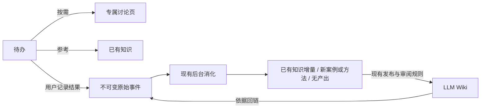

# Agent Note: 待办讨论与执行结果支撑 LLM Wiki

Status: proposed

## Problem

用户希望工作项功能服务于 LLM Wiki 的积累与复用。2026-11-10 对照实现后，原[工作项一等页面提案](2026-09-22-work-items-as-first-class-pages.md)需要收敛：点击待办已经能通过 `open_todo_work_item` 打开或创建页面，页内也能调整状态、优先级和截止日期。将全部 `todos` 迁移为页面的直接收益有限，却会影响提醒、同步、冲突裁决和历史兼容。

当前需要解决的具体问题：

- `related_wiki_slug` 同时表示参考知识与专属讨论。多个待办可以引用同一页，而 `_WorkItemPanel` 只显示第一个匹配项，公共知识页可能出现某个任务的专属状态栏。
- 初建页面把任务状态、优先级、截止日期复制进 Markdown，之后更新只写待办记录，正文与顶部控件可能不一致。
- 完成待办只表示用户勾选完成，不包含实际结果、有效方法与失败原因。创建一个页面不会自动补齐这些事实，也不会自动形成可引用知识。

本提案是旧方案的收敛替代候选；当前仅完成设计，尚未实施。原提案保留历史依据，不将其中的全量模型迁移默认列为后续开发任务。

## Proposal

保留待办业务模型，按需提供专属讨论空间，让用户主动记录的执行结果进入现有事件与 Wiki 消化链路。

### 用户流程

以“配置自动备份”为例：

1. 创建待办，可以关联“备份与恢复”知识页作为参考。此时只创建待办。
2. 需要深入思考时点“讨论任务”，打开该任务自己的讨论页。顶部显示实时任务字段、参考知识链接，下方保存过程笔记与页内对话。
3. 完成时直接勾选即可。若有经验值得保留，可以点“记录结果”，写下实际采用的方法、观察到的结果、适用条件或踩坑，不要求填满模板。
4. 保存结果立即落为原始记录，不等待模型或网络。已有后台消化判断是否有可复用增量：补充已有知识、形成案例/方法，或者无产出。
5. 任务详情显示原始结果及对应知识产出/待审提议。以后询问备份问题，LLM Wiki 可以引用这份经验，并回到用户当时的结果原文。

完成任务和保存结果是两个独立动作。结果保存失败不撤销完成状态，保留输入草稿并明确提示未保存。没有结果原文时，系统不得把一个完成勾选解释为某种方法已经验证有效。

### 数据归属

| 对象 | 唯一负责的内容 | 更新方式 |
|---|---|---|
| `todos` | 标题、当前状态、优先级、截止日期、提醒、任务补充说明 | 现有待办 API、确认制写入及同步冲突规则 |
| 任务讨论页 | 任务自己的过程笔记、讨论入口 | 按需创建，复用页面编辑与会话能力 |
| 原始结果事件 | 用户报告的执行事实与结果 | 不可变记录，纠正通过补充记录表达 |
| Wiki 知识页 | 有依据、可复用的案例、方法、规律与适用条件 | 现有消化、去重、来源、依赖与审阅流程 |

页面顶部实时读取待办，不再把当前字段生成到 Markdown。AI 讨论时按明确任务 ID 读取字段，并在输入/运行中绑定状态版本；生成开始后的变更不能悄悄改写这次请求的上下文。过程笔记里的历史状态保留历史含义。

### 讨论归属与参考关系分开

首批建议增加 `todos.discussion_page_id`，保留 `related_wiki_slug` 表示参考知识：

- 一个任务至多一个专属讨论页，一张讨论页至多属于一个任务，以稳定页面 ID 关联。
- 多个任务可以参考同一知识页。参考页展示关联待办列表，不任取一个任务作为页面主人。
- 首批保留一个固定参考知识页；对话仍可检索其他材料，暂不增加多对多管理界面。
- 专属页采用受限的 `work_item` 页型，复用现有编辑和页内聊天。在普通知识列表中默认不混排，用户仍可从待办、历史或明确筛选找到。
- `work_item` 不进入普通自动知识召回、素材编译和知识依据，也不允许后台整篇改写。该限制必须落实到服务端各入口，不能只隐藏 UI 或依赖可编辑标签。
- 显式打开可以讨论过程材料，但 AI 建议仍是建议，不成为已执行事实。知识依据必须来自实际结果事件或其他有效来源。

“讨论任务”打开专属页，“查看参考知识”打开参考页。专属状态栏直接查询准确任务，包含已完成/归档记录，不再遍历默认待办列表取第一个匹配项。

### 结果记录复用已有消化

新增业务动作是“记录结果”，不是手动触发消化：

- 统一录入路径原子提交用户原文、input record、任务关联、分析/消化任务和出站同步。现有 `input_records.todo_id` 可用于关联，但必须在广播前写入，不能提交同步后再补字段。
- 提交绑定任务 ID、客户端幂等键与用户原文。同键同请求返回同一结果，同键改变任务或原文报错，不制造重复事件或串挂任务。
- 提交时保留任务标题、状态、记录时点等上下文，与用户原文分开；任务后来改名不重写事件。上下文版本如何存储和同步在实施路线明确，不假设现有字段已经完整支持。
- 允许进行中记录阶段结果、完成后补充结果。纠正新增原始记录并明确指向被纠正结果，不覆盖旧事实，也不能默认把矛盾的新旧结果都当成现行结论。
- 结果是“用户报告”，不是外部验证；后台保留适用条件与局限，不从全部聊天推断任务执行成功。
- 复用已有相近知识候选、修订依据绑定、无增量去重。优先补已有知识，有独立案例价值才新建；“已完成”等信息不足时允许零产出。
- 人类编辑、规则及其他受保护内容继续走已有审阅；未受保护参考知识沿用已有发布规则，不另建一套提炼、审批和重试队列。

任务详情只读显示“结果已保存 / 后台处理中 / 无可复用内容 / 知识产出或待审提议”，从已有任务状态与事件来源关系查询。旧消化任务失败按原退避重试，不新增“立即消化”按钮。没有创建讨论页时也能记录结果和查看产出，不为保存一次结果强制生成页面。

### 历史、删除与跨设备兼容

历史待办不批量建页，不凭 `related_wiki_slug` 就认定页面属于某任务。

| 旧数据形态 | 处理方式 |
|---|---|
| 没有关联页 | 保留待办，首次讨论才创建专属页 |
| 关联普通主题、项目、人物等页面 | 保留参考关系，讨论另建专属页，原页会话保持原归属 |
| 唯一且匹配的 `work-item-id:<todo_id>` 标记，无其他归属冲突 | 保留原页面 ID、正文、会话，补明确讨论归属；改变页型会影响已有来源/依赖时转人工复核 |
| 多任务共用、标记冲突、页面缺失等不明确情况 | 保留原关联与内容，提示检查，不任意选任务、不合并会话、不静默创建替代内容 |

专属页面身份从任务 ID 稳定派生，本地建页与挂接同事务。重复打开、崩溃重试、两设备同时首次讨论不能产生两张专属页面。正文或归属冲突进入现有显式冲突处理，不凭标题收养旧页。

旧正文里的状态作为历史文本保留，能明确识别的旧生成区块注明创建时快照；无法识别的人工正文不批量删改。状态读取始终以待办字段为准。

完成、重开或归档不删除页面、会话、结果和知识。删除待办不级联删除已有依据；保留讨论归属和历史任务标识，页面显示“原任务已删除”，仍可从历史入口访问。不能留下既查不到任务又误挂到另一任务的页面。参考页或讨论页被删除/尚未同步时，明确显示不可用/等待，不相互替代。

当前 TodoRecord 是整行同步，新增字段必须同时覆盖增量、快照、冲突裁决、删除与重放。旧客户端不能用缺少新字段的整行覆盖清空讨论归属；不支持新关系/页型的版本应明确要求升级。实施前列明 schema/协议兼容门禁，不能只交付本机 UI。

### 分批范围

| 批次 | 范围 | 用户得到的收益 |
|---|---|---|
| A：连接与状态一致性 | 讨论/参考分离、实时状态、按需建页、历史与同步兼容、过程页隔离 | 公共知识不串任务，讨论归属固定，状态显示一致 |
| B：结果支撑 Wiki | 可选结果录入、幂等原始记录及关联、已有消化复用、依据和产出回链 | 做过的事情能形成有依据、以后可复用的经验 |

建议先实施 A，验证现有使用流程；B 后置，通过实际任务样本再判断收益。两批都保留 `todos` 与当前导航，不把普通提醒自动升级成知识页。本设计是待评审方案，不代表两批已经实施或已经取得真实模型验收结果。

## Alternatives considered

- 全量待办页面化：数据外观一致，但会重做提醒、同步和迁移；现有讨论能力已存在，目前增量收益不足。
- 继续让参考页兼任讨论页：改动少，却混淆公共知识与任务过程，会让多个任务串用一个状态栏。
- 每次状态变化重写 Markdown：容易覆盖人工笔记并制造同步冲突；实时字段需要唯一来源，历史正文应保留历史含义。
- 自动把全部任务和聊天写入知识：把计划、AI建议和已发生事实混合，缺少有效依据。
- 独立“提炼经验”按钮和处理队列：复制已有消化、去重、审阅及失败恢复，违反知识后台无手动触发入口的约束。
- 完成时强制复盘：让普通任务变重；可选结果记录允许低信息任务自然结束。

## Acceptance criteria

- 两个任务参考同一知识页时，专属讨论和状态互不串用，参考页仍展示完整关联列表。
- 待办列表、任务详情、讨论上下文中的实时字段一致；生成中的请求绑定其输入版本。
- 创建普通待办/提醒不产生页面；重复/跨设备首次讨论至多产生一个专属归属，失败无半挂接。
- 归档任务能打开原讨论；完成和删除不丢会话、原始结果及知识。含糊的历史关联不被静默修改。
- 过程页不进入普通知识依据；显式讨论不把 AI 推测转换成已执行事实。
- 离线、无 Provider 时能完成任务并保存结果；重复提交不重复，幂等冲突不串任务，结果保存失败保留草稿。
- 备份任务的成功、失败、无增量、已有知识更新及补充纠正样本验证来源、去重、版本失效和人类编辑保护；另以真实任务/模型验证经验质量。
- Rust存储/迁移/同步、真实隔离Bridge、中英文窄屏和错误恢复覆盖各批次。实际命令和结果由未来实施路线记录，本次文档校验不替代运行测试。

## Risks

- 新页型需要检查所有召回、编译、写入与导出入口，只过滤一处会让过程材料漏进知识依据。
- 已被引用的旧工作项页和含糊关系不能无损自动分类，必须允许人工复核。
- 同步整行协议与旧客户端兼容是 A 的主要成本，不能用先做 UI 的方式跳过。
- 执行结果质量决定 Wiki 收益，必须允许无产出，区分用户报告与外部验证。
- 任务删除、结果纠正后的历史身份与依据需要显式保留；不能级联删除原始事件，也不能继续采用已被纠正的结论。
- A 仍有迁移和同步成本；若实际使用很少需要持续任务讨论，可以后置整项，不为了架构统一扩大开发。
